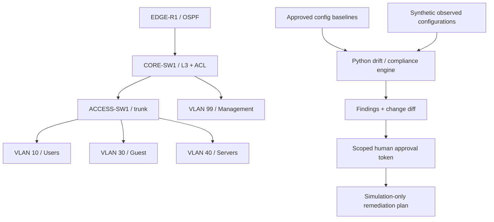

# Enterprise Network Security Automation

[](https://github.com/hossainmobin8353-sudo/enterprise-network-security-automation/actions/workflows/tests.yml)

**Advanced Tier III/Tier IV portfolio lab** — Cisco-style network segmentation, OSPF routing templates, configuration drift detection, security policy evaluation, Python automation, approval-bound remediation simulation, and automated tests.

> **Validation status:** Python unit/CLI tests executed offline. Network hardware, SSH, Hyper-V, GNS3, EVE-NG, OSPF adjacency, and end-to-end packet isolation have **not** been tested. No network configuration is automatically changed by this project.

## Design



## Engineering capabilities

- Network architecture: users/guest/servers/management VLANs, L3 gateways, basic OSPF configuration templates, 802.1Q trunk, explicit guest-management ACL isolation.
- Network security: detect missing ACL binding, forbidden Telnet, and missing service password obfuscation. **Note** `service password-encryption` is weak reversible obfuscation, not a modern password security control; use stronger secrets, SSH/AAA, and platform hardening in a production design.
- Automation: deterministic baseline comparisons and unified diffs, synthetic fleet-wide device collection fixtures, scoped HMAC approval workflow, and safe simulation command.
- Assurance: 16 unit tests, 4 CLI integration tests, Windows-hosted GitHub Actions. No hardware test coverage implied.
- Safety: no network write operations; no destructive remediation; example configs and data are fictional.

## Quick start (Windows PowerShell)

Requires **Windows 10/11, PowerShell, Python 3.10+**. No Cisco hardware needed for offline exercises.

```powershell
# Unzip project and open PowerShell from its root
.\scripts\setup-windows.ps1

# Run the report and preview expected changes
.\.venv\Scripts\python.exe -m netguard.cli scan
.\.venv\Scripts\python.exe -m netguard.cli plan --device CORE-SW1

# Simulation-only approval demonstration (never touches equipment)
$env:NETGUARD_APPROVAL_SECRET = 'replace-with-a-random-32-plus-character-lab-secret'
.\.venv\Scripts\python.exe -m netguard.cli approve --device CORE-SW1
# Copy the returned token and paste it into the next command:
.\.venv\Scripts\python.exe -m netguard.cli simulate --device CORE-SW1 --token 'PASTE_TOKEN_HERE'
```

`simulate` confirms approval scope against the device and config hash. It does **not** update running configuration, transfer backups, restart devices, or make network connections.

## Expected synthetic findings

The observed CORE-SW1 deliberately omits the guest ACL deny statement and inbound binding. The scan reports three findings: one medium configuration drift and two critical guest-to-management ACL findings. Other two nodes match baselines.

## Repository layout

```text
src/netguard/                  Policy/approval engine, CLI
configs/baseline/              Approved fictional Cisco configuration templates
configs/observed/              Synthetic current state (one drifted switch)
data/policy.json               Inventory and required security controls
tests/                         Unit and CLI integration tests
scripts/                       Windows PowerShell setup/demo scripts
docs/                          Architecture, simulator plan, validation matrix
.github/workflows/tests.yml    Windows CI checks
evidence/                      Captured offline evidence
```

## Simulator follow-through

See [`docs/simulator-validation.md`](docs/simulator-validation.md) for the follow-up build in GNS3 or EVE-NG. Real devices and simulated IOS appliances have implementation-specific interfaces, licensing, and feature constraints. Record your actual validation evidence before adding claims about functioning routing, failover, or ACL enforcement.

## How this supports an engineering interview

Explain **why** segmentation separates users, guests, servers and management; show the real diff and policy findings; demonstrate the scoped approval check; then discuss deployment risk, change windows, rollback strategy, tests, error handling, and auditability. Clearly distinguish a source-code policy validator from an actual configuration management controller.

**Ethics:** Work only on equipment and networks you own or are authorized to test. Never upload employer configurations, credentials, system inventories, or restricted DoD details.

MIT License.
