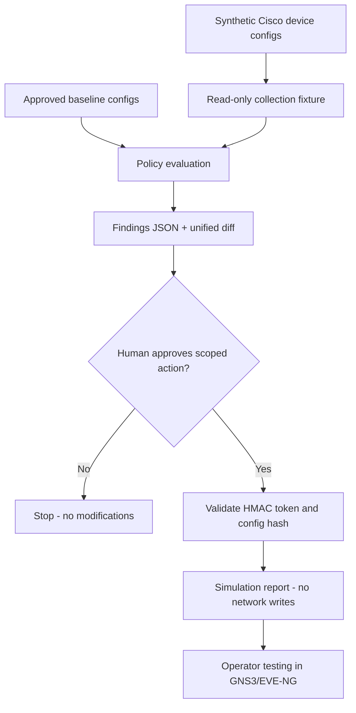

# Architecture and threat model



## Scope and safety
- **No SSH/NETCONF/RESTCONF connection code is present.** Entire engine is offline.
- No device password, private key, or real enterprise configuration data is included.
- A token is bound to device identity and observed configuration hash and expires after at most 15 minutes.
- Token is not a substitute for approval workflow in production; it is a teaching demonstration. Tokens are not single-use; do not reuse this design for production.
- There is no automated device configuration write or rollback. Production operations require change tickets, privilege separation, backups, and supervised validation.

## Topology
```
            EDGE-R1 (OSPF area 0)
                    |
              CORE-SW1
         inter-VLAN / L3 / ACL
                    |
             ACCESS-SW1
            /    |     \
       Users   Guest   Servers
      VLAN10  VLAN30   VLAN40
            Mgmt VLAN99
```

Network addresses are documentation-only private RFC1918 addresses. Configurations are templates and may require command adjustments per virtual IOS image.
